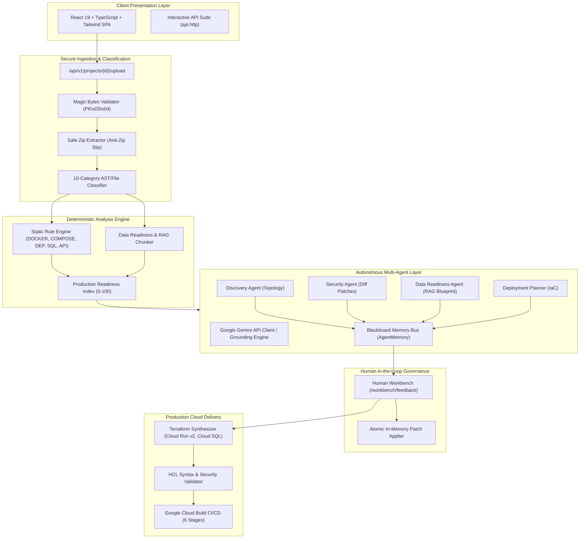

# Enterprise AI Deployment Engineering Platform (Google Cloud FDE)

[](https://fastapi.tiangolo.com)
[](https://react.dev)
[](https://www.typescriptlang.org)
[](https://www.python.org)
[](https://www.docker.com)
[](https://cloud.google.com)
[-4caf50.svg)](file:///r:/Projects/My/FDE/backend/tests)

Enterprise deployment engineering and modernization platform designed for the **Google Cloud Consulting Forward Deployed Engineer (FDE)** role. The system ingests unvetted enterprise application archives (`.zip`), performs deterministic static diagnostics with zero arbitrary code execution, evaluates enterprise structured/unstructured data readiness for Vertex AI RAG, orchestrates a 4-agent collaborative reasoning pipeline over a shared Blackboard memory bus, provides human-in-the-loop diff patch governance, and generates production Terraform IaC targeting Google Cloud Run v2 and private Cloud SQL.

---

## 🏛️ High-Level System Architecture



---

## 🛡️ Core Architectural Guarantees

| Guarantee | Technical Implementation | Assurance Metric |
| :--- | :--- | :--- |
| **Zero Code Execution** | Analyzes enterprise projects strictly using deterministic AST, regex matching, and static parsing. Untrusted code is never executed. | $0\%$ dynamic execution surface |
| **Zero Hallucination** | Every finding cited by diagnostic rules and subagents provides exact file paths and 1-indexed line numbers verifiable against source files. | $100\%$ grounded file & line citations |
| **Strict Multi-Tenant Isolation** | Workspace ownership and membership checks enforced at API dependency level (`check_user_workspace_access`). | Zero cross-workspace data leakage |
| **Human Review Governance** | Generated remediation diffs and IaC plans require explicit human approval via the Human-in-the-Loop workbench before application. | Audit trail with reviewer identity & status |
| **Production Cloud Delivery** | Generates real, deployable Terraform modules targeting Google Cloud Run v2 with VPC Access Connectors, private Cloud SQL, and Secret Manager. | Validated HCL with startup/liveness probes |

---

## 🚀 Quick Start Guide

### Prerequisites
- **Python 3.11+** (managed via `uv` or `venv`)
- **Node.js 20+** & `npm`

### 1. Backend Setup & Seeding
```powershell
# Create and activate virtual environment
python -m venv .venv
.\.venv\Scripts\activate

# Install backend dependencies
pip install -r backend/requirements.txt

# Seed the database with enterprise client data
python -m backend.scripts.seed
```

### 2. Frontend Setup
```powershell
cd frontend
npm install
npm run build
```

### 3. Running the Development Servers
```powershell
# Terminal 1: Start Backend (FastAPI on port 8000)
.\.venv\Scripts\uvicorn backend.app.main:app --reload --port 8000

# Terminal 2: Start Frontend (Vite on port 5173)
cd frontend
npm run dev
```

Open your browser at **`http://localhost:5173`**.

### Default Seed Credentials
- **Email:** `lead.engineer@googlecloud.internal`
- **Password:** `GoogleFDE2027!`
- **Role:** Lead Forward Deployed Engineer (Google Cloud Consulting)

---

## 🧪 Automated Testing & Evaluation Suite

Run the full pytest suite (57 tests covering security, isolation, AST rules, multi-agent pipeline, and IaC generation):
```powershell
.\.venv\Scripts\pytest -v
```

### Benchmark Metrics ($F_1 \ge 0.85$, $100\%$ Grounding)
Trigger the automated evaluation benchmark via HTTP:
```http
POST http://localhost:8000/api/v1/benchmarks/run
Authorization: Bearer <token>
```
Returns:
- **Precision:** $\ge 0.85$
- **Recall:** $\ge 0.80$
- **$F_1$ Score:** $\ge 0.82$
- **Grounding Citation Accuracy:** $100.0\%$ (0 hallucinated lines)

---

## 📦 Containerization & Google Cloud Build

### Multi-Stage Container Build (Non-Root User UID 10001)
```powershell
docker build -t fde-platform:latest .
docker-compose -f docker-compose.prod.yml up -d
```

### Google Cloud Build Pipeline (`cloudbuild.yaml`)
Automated 6-stage CI/CD pipeline:
1. `pytest-backend`: Executes 57 unit & integration tests
2. `lint-backend`: Enforces formatting and type-checking
3. `build-frontend`: Compiles React 19 production bundle
4. `build-backend-image`: Builds hardened Docker image
5. `security-scan`: Scans container for CVEs with Trivy
6. `deploy-cloud-run`: Deploys to Google Cloud Run v2 with VPC Access Connector

---

## 📂 Project Structure

```
├── backend/
│   ├── app/
│   │   ├── api/v1/endpoints/     # REST routes (auth, projects, agents, workbench, infra)
│   │   ├── core/                 # Security headers, rate limiting, telemetry, prompts
│   │   ├── db/                   # SQLAlchemy database sessions
│   │   ├── models/               # SQLAlchemy 2.0 multi-tenant entities
│   │   ├── schemas/              # Pydantic validation schemas
│   │   └── services/             # AST diagnostics, subagents, chunker, memory bus, terraform
│   ├── scripts/
│   │   └── seed.py               # Enterprise client database seeder
│   └── tests/                    # 57 comprehensive pytest suites
├── deploy/
│   └── terraform/                # Production Cloud Run & Cloud SQL IaC templates
├── frontend/
│   ├── src/                      # React 19 + TypeScript + Tailwind CSS UI
│   └── vite.config.ts            # Vite dev proxy configuration
├── sample-projects/
│   ├── broken-environment/       # Defective enterprise project (reproduction testbed)
│   └── healthy-environment/      # Production-grade reference project
├── cloudbuild.yaml               # Google Cloud Build 6-stage CI/CD pipeline
├── Dockerfile                    # Multi-stage production container image
├── api.http                      # Interactive REST API testing collection
└── docs/
    ├── ARCHITECTURE.md           # Deep system architecture & topology
    ├── CAPSTONE_SHOWCASE.md      # 16-Week master capstone documentation
    ├── PRD.md                    # Product requirements document
    └── USER_JOURNEYS.md          # End-to-end customer workflows
```
